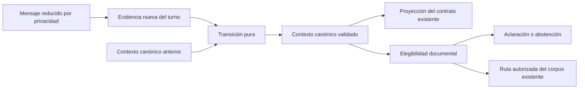

# Estabilización del contexto conversacional

Base: `1cd9556`, rama `fix/dni-classification-context`, PR #2. Esta intervención sustituye las restauraciones de estado por una transición canónica. No amplía el catálogo documental ni introduce modelos, dependencias o cambios de arquitectura.

## Diseño definitivo



`classification.py` conserva los reconocedores existentes, extrae una `EvidenciaTurno` inmutable y adapta la salida al contrato anterior. El extractor **no recibe contexto previo**: no puede rellenar edades ni operaciones antiguas. No se añade un segundo clasificador ni llamadas LLM.

`context_policy.py` contiene el único escritor del contexto: `transicionar(anterior, evidencia)`. Es una función pura, copia el estado recibido y no consulta mensajes, archivos, etiquetas de trámite, servicios o proveedores. `validar_contexto` comprueba la coherencia; `ruta_documental` calcula la elegibilidad directamente desde ese contexto.

### Estado mínimo

| Elemento | Contenido y vigencia |
| --- | --- |
| `turno`, `revision` | Contadores internos. La revisión vincula los datos al objetivo/titular actual; no es una credencial ni un mecanismo de autorización. |
| `titular`, `edad`, `operacion` | Cada dato contiene `valor`, `estado` —desconocido, confirmado o conflicto—, `turno` de evidencia, `revision` y `origen` —ausente, explícito u observación—. |
| `rechazadas` | Operaciones rechazadas de esta revisión. Persisten aunque se resuelvan otras dimensiones. |
| `pendientes` | Única colección autoritativa de dudas: motivo y clase faltante/contradicción. |
| `propuesta_operacion` | Hipótesis provisional; no rehabilita una operación rechazada ni autoriza recuperación. |
| `tema`, `consulta_pendiente`, `retomar` | Tema actual, tema que espera aclaración y tema resuelto que se debe responder en este turno. No contienen copias de preguntas. |
| `ultima_ruta` | Presentación histórica del último trámite confirmado. Nunca se descompone para recuperar una operación o una edad. |

El contexto solo contiene categorías y metadatos de vigencia. No añade nombres, números de DNI, edades exactas, textos de usuario ni datos consulares. `EvidenciaTurno` es transitoria; los checkpoints almacenan diccionarios y listas del contexto canónico, no un nuevo historial de evidencias.

Los campos anteriores (`intencion`, `tramite_actual`, `operacion_dni`, `decision`, etc.) son una proyección de salida para conservar compatibilidad. No se utilizan como entrada para reconstruir hechos. Por ejemplo, `tramite_actual` puede seguir mostrando el último trámite mientras una duda lo bloquea; eso no autoriza documentos. `decision.evidencias` distingue los rechazos vigentes de las observaciones del turno. La fuente de autoridad es `contexto_canonico`.

## Política e invariantes

| Invariante | Aplicación |
| --- | --- |
| 1. Herencia no equivale a confirmación | Los datos conservan su turno de origen. Solo evidencia nueva del campo puede confirmar un conflicto de ese campo. Una mención de hijo sin edad no produce evidencia de edad. |
| 2. Rechazo persistente | Se vacía la operación rechazada y se registra en `rechazadas`. Una observación de tenencia/caducidad no levanta el rechazo; hace falta una aceptación explícita posterior. |
| 3. Independencia de dimensiones | Resolver edad no confirma procedimiento; resolver documento no confirma operación. La transición mantiene las demás dudas. |
| 4. Sin mezcla de titulares | Los datos llevan revisión. Un cambio real de titular o la introducción de varios candidatos invalida el contexto dependiente anterior. |
| 5. Completar no sustituye | Si el titular era desconocido, completarlo conserva la operación y el tema de ese pedido. |
| 6. Invalidación dependiente | Al sustituir titular se invalida su edad y la operación anterior, salvo que el nuevo pedido aporte operación explícita. Seleccionar entre candidatos del pedido conserva la operación expresada para ese pedido. |
| 7. Contradicción bloquea | Cualquier duda material impide una ruta documental. La función de redacción también comprueba elegibilidad y limpia fuentes/contexto residuales. |
| 8. Ruta desde el canónico | El recuperador solo se invoca cuando la intención coincide con `ruta_documental(contexto_canonico)`. Etiquetas o flags legados por sí solos no autorizan nada. |
| 9. Consulta clara continúa | Los datos confirmados se conservan para repreguntas; no se exigen nombres ni edades exactas. Seguimiento genérico usa sus propios datos necesarios. |
| 10. Abandono explícito | Fuera de alcance, cancelación y cambio explícito a seguimiento genérico dejan atrás el objetivo anterior. No se trata una aclaración de un campo como confirmación de todos. |

Una observación incompatible con primera inscripción/renovación solo puede resolver una aclaración pertinente de operación/tenencia. Tener pendiente otra cuestión, como edad, no convierte automáticamente esa observación en respuesta a la contradicción del procedimiento. Negar una operación distinta tampoco resuelve esa contradicción.

Las preguntas deterministas existentes siguen solicitando una dimensión cada vez. Si el lenguaje no basta para seleccionar titular, edad u operación, se mantiene la pregunta guiada en vez de inferir información desde la etiqueta histórica. No se atribuye capacidad legal a representantes ni acompañantes.

## Defectos: reproducción y corrección

Se añadieron dos pruebas antes de modificar el clasificador y se ejecutaron sobre `1cd9556`: **ambas fallaron**. Tras la refactorización pasan como pruebas unitarias y las mismas secuencias se verifican con el grafo y proveedores simulados.

| Secuencia | Resultado anterior | Resultado nuevo |
| --- | --- | --- |
| Renovación hijo de 10 años → «Mi hijo es menor de 25 años» → «Es para mi hijo» | Heredaba menor y cerraba la duda de edad | Edad en conflicto; sin nueva evidencia de edad se conserva el bloqueo, sin recuperación ni generación |
| Renovación → «No quiero renovar. ¿Debo presentar el DNI de mi hijo de 25 años?» → «Es un documento de apoyo» | Restauraba renovación desde la etiqueta histórica | Resuelve documento, conserva rechazo de renovación y solicita operación; no recupera requisitos |
| Anterior → «Quiero renovar el DNI» | No distinguía rehabilitación de restauración | Aceptación explícita posterior: levanta rechazo y permite continuar si lo demás está confirmado |

### Los cinco casos de edad

Tras abrir la duda de edad:

| Respuesta | Tratamiento |
| --- | --- |
| «Mi hijo tiene 25 años» | Nueva evidencia de adulto: resuelve la aclaración; renovación adulta sigue sin corpus y se abstiene. |
| «Mi hijo es menor de 25 años» | Límite que admite menores y adultos. No es una edad exacta ni demuestra minoría de 18 años; sigue pendiente. |
| «Es para mi hijo» | Confirma destinatario, no edad; sigue pendiente. |
| «Es para mi hijo de 10 años» | Nueva evidencia de menor: resuelve edad. |
| «Es para mi hijo adulto» | Nueva evidencia de adulto: resuelve edad; abstención documental adulta. |

Sin una aclaración previa, afirmar una edad incompatible con la categoría confirmada abre una duda salvo que haya una asignación/rectificación inequívoca del titular. Un límite menor de 18 permite deducir minoría, pero no almacena ni se convierte en una edad exacta. El reconocimiento lingüístico se mantiene acotado; no se amplía aquí el repertorio general de expresiones.

## Archivos y funciones

- `app/graph/state.py`: `DatoContextual`, `ContextoCanonico`, `EvidenciaTurno` y campo canónico de `DNIState`.
- `app/graph/classification.py`: reconocedores sin herencia, `extraer_evidencia`, `proyectar`, `clasificar` y `pregunta_contextual`. Se eliminan `_clasificar_candidato`, `_operacion_confirmada` y las restauraciones posteriores.
- `app/graph/context_policy.py`: contexto inicial, transición pura, validación, candidato y elegibilidad documental.
- `app/graph/dni_graph.py`: comprobaciones de elegibilidad en recuperación y envoltorio de redacción. El texto del turno y la reducción de privacidad siguen pasando por el flujo existente.
- `tests/test_context_policy.py`: regresiones estructurales y matriz categórica.
- Esta guía y enlace desde la documentación anterior.

## Validación ejecutada

**295 aprobados, 6 de integración excluidos, 12 advertencias de dependencias; 7,12 s; Linux/Python 3.11.17.** Se conservan las 246 pruebas anteriores sin modificar ninguna aserción y se añaden 49 casos. No se han eliminado ni relajado pruebas. Las advertencias proceden de dependencias existentes.

```bash
GRADIO_ANALYTICS_ENABLED=False XDG_CACHE_HOME=/tmp/tfm-cache PYTHONDONTWRITEBYTECODE=1 \
  env -u OPENAI_API_KEY -u TFM_OPENAI_API_KEY \
  .venv/bin/python -B -m pytest -q --tb=short -p no:cacheprovider
```

La matriz nueva incluye los dos defectos antes/después, los cinco casos de edad, rechazos de las tres operaciones reconocidas combinados con cuatro temas, respuestas parciales, órdenes alternativos, pureza de transición, revisión/procedencia, etiquetas históricas contaminadas, propuestas inconsistentes y puertas documentales con flags falsamente resueltos. Una prueba recorre 256 pares de eventos categóricos válidos; es una exploración acotada del modelo, no una prueba exhaustiva del español.

Las pruebas del grafo comprueban fuentes, ausencia de invocaciones al recuperador/proveedor durante las dudas, continuidad de credencial y recuperación correcta al confirmar. La suite incluye aislamiento, reinicio, TTL y borrado; dos casos nuevos comprueban expresamente que los rechazos y el contexto canónico desaparecen con el hilo.

Comparación AST contra `1cd9556`: `redactar_respuesta` completo, verificador factual, función de historial y construcción del grafo idénticos. Comparación Git: controles de seguridad, privacidad, API, servicios de sesiones/TTL/borrado/concurrencia, Gradio, FAISS, corpus, embeddings, credenciales y dependencias intactos. `git diff --check` correcto.

No se ha ejecutado OpenAI real, búsqueda FAISS/embeddings real, Windows nativo ni navegador JavaScript completo. Los proveedores externos de las pruebas son simulados.

## Compatibilidad y despliegue

No se requieren dependencias, variables de entorno, migraciones de base de datos ni claves nuevas. Se conservan las respuestas públicas y la autenticación existentes. Cambia el esquema interno del estado de LangGraph.

**Reiniciar el proceso al actualizar.** Los checkpoints y sesiones son en memoria y se pierden con el reinicio, como antes. No se ofrece migración de estados antiguos. Si falta contexto canónico, no se reconstruyen hechos desde campos históricos; se pide una consulta nueva. Un contexto canónico internamente incoherente se rechaza: la gestión vigente de errores puede exigir iniciar otra sesión. No se modifica esa gestión ni se añade un almacén alternativo.

No existe una incompatibilidad que haya exigido modificar pruebas anteriores. Sí se corrigen conductas inseguras: la edad heredada ya no confirma un conflicto, los rechazos no desaparecen al resolver documentos y los límites de edad no se tratan como edades exactas. Los campos privados del estado y el reconocedor interno `solicitante` no son un contrato público de API.

### Windows PowerShell / Conda

Desde la raíz del repositorio y con las dependencias existentes:

```powershell
conda activate tfm-piloto
python --version
$env:GRADIO_ANALYTICS_ENABLED = "False"
$env:PYTHONDONTWRITEBYTECODE = "1"
python -B -m pytest -q --tb=short -p no:cacheprovider
```

Debe utilizarse Python 3.11. La configuración de pytest excluye integración por defecto; no hacen falta claves OpenAI para esa suite. No modificar `.env` para las pruebas.

Para la validación funcional con el entorno y credenciales ya administrados por el usuario, arrancar mediante `python -m app.ui`, según la [guía de seguridad](seguridad-fase-1.md). Repetir en conversaciones nuevas ambas secuencias defectuosas, cada una de las cinco respuestas de edad, una renovación clara y las repreguntas coste/plazo/cita. Confirmar que aparece la aclaración en los turnos incompletos y que solo se continúa tras evidencia suficiente. Usar exclusivamente datos ficticios.

## Límites y dictamen

La política centraliza consistencia, no garantiza comprensión lingüística exhaustiva. Persisten paráfrasis, referencias a varios titulares y límites numéricos complejos fuera de los reconocedores existentes. No se almacena un registro identificativo de personas. Ante incertidumbre material se pide precisión; no se amplía el corpus ni se inventan requisitos.

La generación LLM todavía recibe el historial limitado existente y puede producir errores factuales incluso con una ruta correcta. El prompt funcional y el verificador quedan deliberadamente fuera de esta intervención y siguen pendientes de la fase correspondiente. La elegibilidad documental no equivale a certificación normativa ni de vigencia del corpus.

**Preparado para revisión técnica y posterior validación local en Windows/Conda.** Esta evidencia no demuestra ausencia de defectos ni valida proveedores reales. El PR #2 debe permanecer abierto y sin fusionar durante la revisión.
