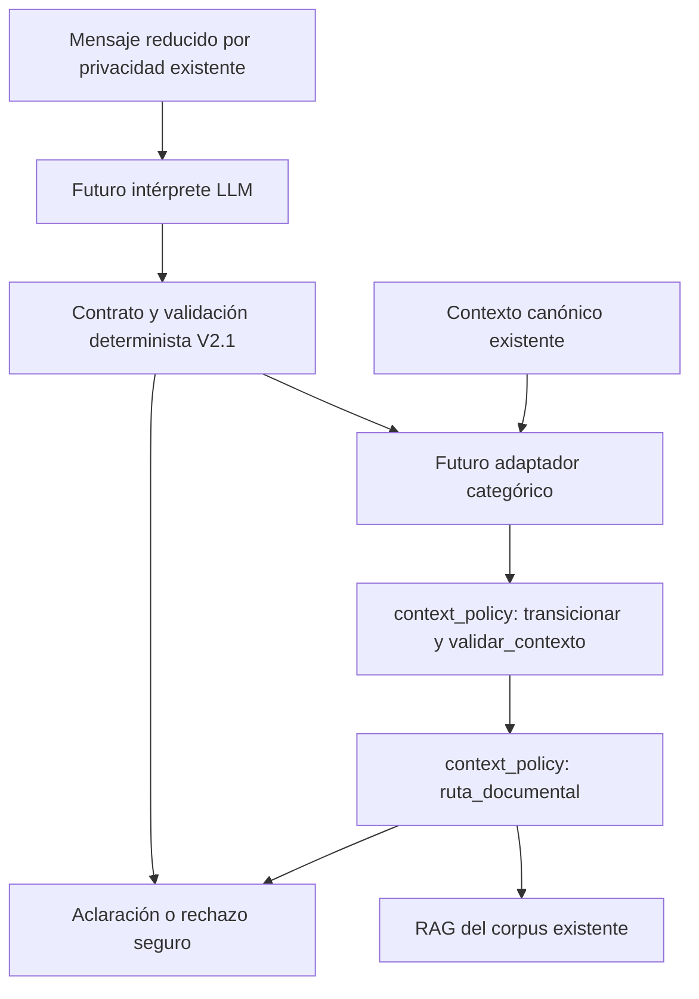

# TFM-piloto V2 — Fase V2.1

## Alcance y base

Rama `feature/v2-hybrid-intent`, base `9b6f85a`. Esta entrega incorpora un contrato local y probado; no incorpora intérprete, proveedor, prompt de interpretación, adaptador ni nodo operativo nuevo. No modifica la clasificación V1, los checkpoints, el corpus, FAISS, generación, verificador, API, Gradio, n8n, seguridad o dependencias. No requiere credenciales ni OpenAI para probarse. No se fusiona el PR #2 ni se modifica `main`.

## Arquitectura objetivo



Solo el contrato y su validación están implementados en esta fase. El recorrido V1 continúa usando `classification.extraer_evidencia`, `EvidenciaTurno`, `transicionar`, proyección y las puertas documentales actuales. `LLMService` sigue dedicado a la respuesta y no recibe llamadas nuevas.

## Contrato

`app/graph/interpretation_contract.py` usa Pydantic ya instalado: tipos estrictos, campos adicionales prohibidos y modelos congelados. No se hacen conversiones de cadenas a números ni de booleanos a enteros. Las colecciones tienen límites y no admiten duplicados. El congelado de Pydantic no equivale a inmutabilidad profunda de listas: el futuro adaptador deberá revalidar el payload en su frontera, sin confiar en objetos construidos o modificados fuera de ella.

`EntradaInterpretacion` contiene exclusivamente `turno >= 1` y `revision >= 0`, asignados por el llamador desde el contexto canónico. No son datos generados por el modelo ni credenciales. No contiene mensajes, nombres o historial. El futuro proveedor recibirá el mensaje reducido por la frontera de privacidad existente; aquí no se define otro almacén de texto ni un nuevo mecanismo de minimización.

`InterpretacionTurno` requiere `version="2.1"`, `evidencias`, `faltantes` y `contradicciones`. No acepta confianza, ruta documental, procedimiento autorizado, explicaciones libres ni identidades. Cada evidencia requiere dimensión, valor categórico, acto, origen y sujeto:

| Dimensión | Valores |
| --- | --- |
| ámbito | dni, fuera_alcance, desconocido |
| titular | descendiente, menor, adulto, propio, desconocido |
| edad | menor, adulto, desconocido |
| operación | primera_vez, renovacion, duplicado, desconocido |
| tema | requisitos, coste, plazo, cita, seguimiento, otra |
| DNI previo | si, no, desconocido |
| función documental | titular, apoyo, ambigua, desconocido |
| referencia a titular | actual, otro, varios, ambigua |

Las claves de máquina de las dimensiones son `ambito`, `titular`, `edad`, `operacion`, `tema`, `dni_previo`, `funcion_documento` y `referencia_titular`. El vocabulario coincide con la política existente cuando hay un concepto equivalente; pruebas verifican esa compatibilidad. Reconocer `duplicado` o una categoría adulta no incorpora documentación para ese procedimiento.

Los actos son `solicitud_afirmativa`, `negacion`, `observacion` y `aclaracion`. La operación negada se expresa mediante evidencia de operación con acto `negacion`, sin un segundo campo agregado que pueda discrepar. Negar primera inscripción no afirma renovación. Una observación de tenencia no se convierte en solicitud afirmativa. Una aclaración explícita puede completar la interpretación, pero su pertinencia para una duda canónica anterior corresponde a la política, no al contrato.

`origen` distingue `explicito_turno` de `referencia_contextual`. `sujeto` distingue `objetivo`, `otro` y `no_resuelto`: son vínculos locales al turno, nunca IDs persistentes de personas. La evidencia ajena no completa edad u operación del objetivo. Varios titulares o una referencia contextual no resuelta bloquean conservadoramente la suficiencia. No se inventan identificadores entre turnos ni se copia evidencia previa como nueva.

`faltantes` y `contradicciones` usan solo códigos cerrados: ambito, titular, edad, operacion, tema, dni_previo, documento, referencia, contradiccion. Son declaraciones del proveedor que pueden añadir bloqueos; no sustituyen los controles calculados localmente.

## Validación y estados

La frontera pública es `validar_interpretacion(entrada, salida)`: acepta metadatos en dict y salida en dict o JSON; devuelve `ResultadoInterpretacion`. No acepta instancias de modelos preconstruidas. El esquema puede obtenerse con `InterpretacionTurno.model_json_schema()`; las validaciones semánticas siguen siendo obligatorias aunque el futuro proveedor soporte JSON Schema.

| Estado calculado localmente | Significado |
| --- | --- |
| suficiente | Interpretación local completa según controles conservadores, nunca permiso documental |
| requiere_aclaracion | Faltantes, contradicciones o referencias materiales no resueltas |
| insuficiente_o_invalida | Sin evidencia o fallo de formato, tipos, versión, estructura o metadatos |

La frontera detecta valores incompatibles con la dimensión, claves JSON repetidas, extras, duplicados y JSON malformado. Limita el JSON a 16384 caracteres y la lista a 32 evidencias. Los errores malformados devuelven un resultado fijo sin payload ni excepción del proveedor. No se registran errores Pydantic ni respuestas sin validar; no se debe volcar `ValidationError.errors()`, que puede contener entradas originales. Los modelos ocultan entradas en su representación de errores, pero esa opción no autoriza logging de excepciones o payloads.

La validación semántica calcula conflictos entre afirmaciones distintas de la misma dimensión y entre afirmaciones y negaciones iguales, independientemente del orden. También bloquea primera inscripción con DNI previo y renovación/duplicado sin DNI previo. Los conflictos semánticos conservan categorías válidas para pedir aclaración, sin elegir arbitrariamente una alternativa. Una rectificación dentro del mismo turno necesita una futura política de resolución; V2.1 conserva el bloqueo si ambas afirmaciones llegan al contrato.

Para suficiencia de un procedimiento se exige ámbito DNI, titular, edad, operación y solicitud/aclaración explícita de esa operación. Seguimiento requiere ámbito DNI y solicitud/aclaración explícita del tema, conforme a su carácter genérico actual. Tema `otra`, función documental y tenencia pueden estar ausentes si no hay duda declarada o detectada: su ausencia no inventa hechos. El contrato no comprueba la verdad lingüística del mensaje ni resuelve conflictos con un contexto anterior que no recibe.

Ejemplo sintético (sin datos personales):

```python
from app.graph.interpretation_contract import validar_interpretacion

resultado = validar_interpretacion(
    {"turno": 1, "revision": 0},
    {"version": "2.1", "evidencias": [
        {"dimension": "ambito", "valor": "dni",
         "acto": "observacion", "origen": "explicito_turno", "sujeto": "objetivo"},
        {"dimension": "tema", "valor": "seguimiento",
         "acto": "solicitud_afirmativa", "origen": "explicito_turno", "sujeto": "objetivo"}
    ], "faltantes": [], "contradicciones": []},
)
assert resultado.estado == "suficiente"
# No contiene ruta ni modifica contexto; no invocar RAG desde este resultado.
```

## Integración futura y conflicto con la política canónica

No se implementa conversión automática a `EvidenciaTurno`. Su dataclass actual expresa banderas y una sola operación; no representa directamente tenencia previa de DNI, actos por dimensión, vínculos de sujeto ni todo el vocabulario nuevo de dudas. `context_policy.PRIORIDAD` tampoco acepta `referencia`, `ambito` o `tema` como pendientes. Copiar estos códigos al canónico rompería `validar_contexto`; descartar los que no caben podría autorizar documentos indebidamente. Esta fase no refactoriza esa política.

La alternativa recomendada es un adaptador determinista explícito y probado en una fase posterior. Debe:

1. Revalidar salida y metadatos, rechazar resultados obsoletos respecto a turno/revisión y no confiar en campos autodeclarados de estado o confianza.
2. Resolver referencias contra el contexto canónico autorizado, nunca contra etiquetas históricas o un historial paralelo; impedir mezcla o herencia entre titulares.
3. Conservar rechazos y procedencia al traducir categorías inequívocas al `EvidenciaTurno` existente. No mapear observación a solicitud ni apoyo a titular.
4. Ante cualquier duda material, incluso no representable en la política actual, terminar el turno en aclaración/abstención sin recuperar ni generar respuesta documental. Limpiar fuentes y contexto residuales; un contexto anterior válido o una ruta histórica no son fallback seguro.
5. Solo tras validación de procedimiento, ejecutar `transicionar`, `validar_contexto` y `ruta_documental`. Si hacen falta cambios canónicos, diseñarlos y probarlos por separado antes de conectar el adaptador.
6. Conservar las comprobaciones del grafo que exigen coincidencia entre intención y ruta canónica. Una salida suficiente puede seguir siendo incompatible con el contexto o corresponder a un procedimiento sin corpus.

No se añade el resultado a `DNIState`, historial, logs ni checkpoints. En la futura integración será transitorio y el único estado conversacional persistido seguirá siendo el canónico, con sus mecanismos existentes de revisión, TTL y borrado.

## Criterios de aceptación y validación

- Esquema estricto y versionado, con categorías para todas las dimensiones solicitadas y los cuatro actos lingüísticos.
- Resultado local fail-closed ante entradas inesperadas y contradicciones; ausencia de campos personales, confianza y autorización documental.
- Pruebas de salida válida, incompleta, vacía, negada, observada, aclarada, contradictoria, malformada, mult titular, procedencia contextual y compatibilidad de vocabularios.
- Archivos operativos V1 y dependencias idénticos a `9b6f85a`; contrato sin imports desde el recorrido operativo.
- Pruebas deterministas sin servicios OpenAI reales.

Desde la raíz, con Python 3.11 y el entorno existente:

```bash
export GRADIO_ANALYTICS_ENABLED=False PYTHONDONTWRITEBYTECODE=1
.venv/bin/python -B -m pytest tests/test_interpretation_contract.py -q -p no:cacheprovider
.venv/bin/python -B -m pytest -q -p no:cacheprovider
```

Referencia antes del contrato: 295 aprobadas, 6 de integración excluidas. Contrato: 60 aprobadas. Las pruebas de integración siguen fuera de esta fase y no se certifica OpenAI real, exactitud semántica del futuro intérprete ni calidad documental. Persisten posibles omisiones o categorías incorrectas del modelo; ninguna validación de esquema demuestra que una interpretación sea fiel al mensaje. La evaluación lingüística, el adaptador, las referencias entre turnos y la pertinencia de aclaraciones quedan pendientes de fases posteriores.
