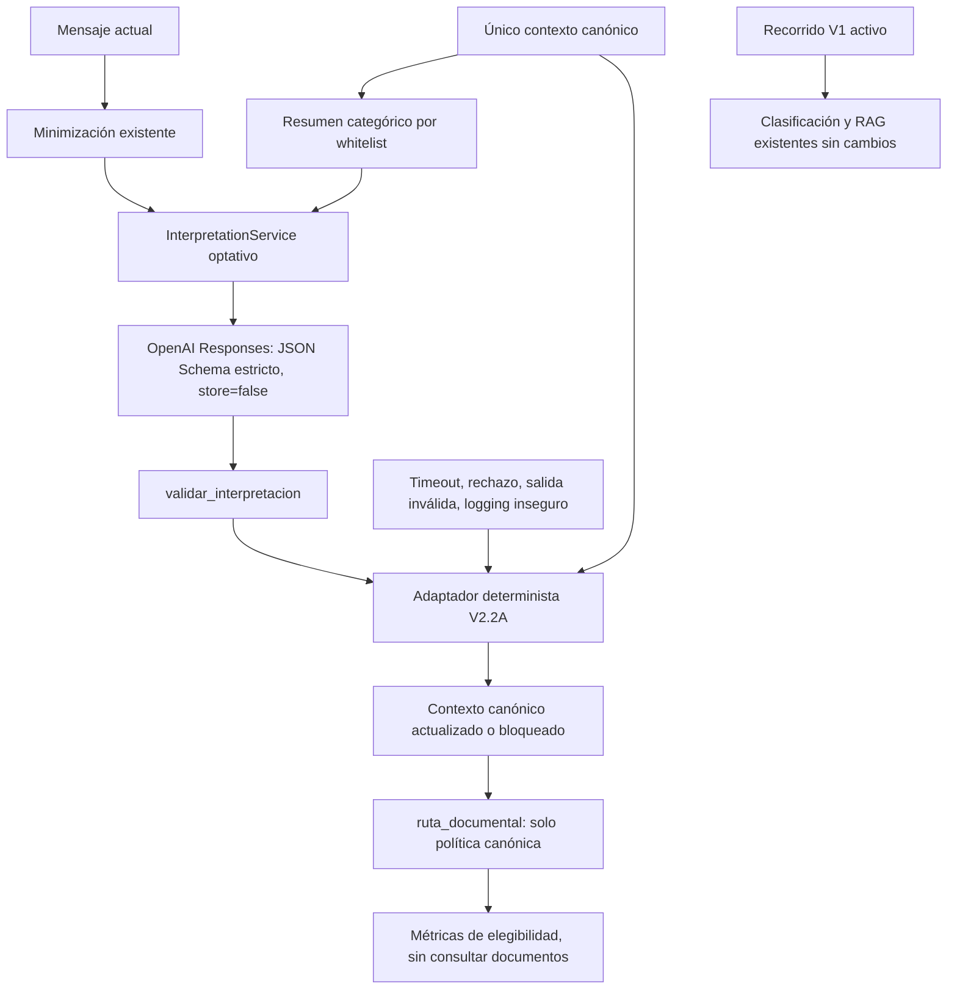

# V2.2B — Intérprete LLM estructurado y evaluación controlada

Esta sección documenta V2.2B. La evaluación actual incorpora [observabilidad y métricas por etapas V2.2C](v2.2c-observabilidad.md), sin cambiar el intérprete operativo ni su prompt.

Base: `6c1faa1`, rama `feature/v2-hybrid-intent`. La implementación permanece fuera del recorrido operativo de FastAPI, Gradio y LangGraph. No sustituye clasificación V1, no ejecuta RAG y no cambia generación, verificador, corpus, FAISS, n8n, autenticación, minimización, sesiones o concurrencia. No añade dependencias ni configuración obligatoria al piloto activo.

## Diseño



`app/services/interpretation_service.py` reutiliza el SDK OpenAI, `settings.openai_model` (actualmente `gpt-4.1-mini`), `openai_api_key` y `provider_timeout_seconds`. Crea su cliente de forma perezosa con `max_retries=0`; no modifica el servicio `LLMService` de generación. `close()` libera el cliente al terminar una evaluación. Inyectar un cliente permite pruebas sin red.

Se utiliza Responses API con `text.format.type=json_schema`, `strict=true`, objetos cerrados y campos requeridos. El esquema procede de `InterpretacionTurno.model_json_schema()`; `const` se normaliza a `enum` de un elemento. No se añaden campos de confianza, rutas ni instrucciones documentales. Los límites de colección y los validadores semánticos siguen aplicándose localmente, aunque el proveedor acepte el esquema.

El prompt de interpretación es nuevo y versionado (`v2.2b-1`); los prompts de respuesta V1 permanecen intactos. Distingue los cuatro actos, observaciones de tenencia frente a solicitudes de operación, cambios de titular incluso entre dos descendientes, documentos de apoyo, ambigüedades y procedencia explícita frente a referencias. No convierte negaciones en afirmaciones alternativas ni «hijo» o «menor de 25» en minoría confirmada. El contenido ciudadano y el resumen se tratan como datos de un mensaje de usuario, separados de las instrucciones.

El contexto enviado contiene solo ámbito, tema, pendientes, rechazos, consulta pendiente y valor/estado/origen de titular, edad, operación, DNI previo y función documental. Omite historial, preguntas anteriores, respuesta anterior, última ruta, identificadores de sesión, metadatos internos de vigencia y credenciales. Un contexto con campos extra o incompatible se rechaza antes de llamar al proveedor. Las credenciales se usan exclusivamente en la autenticación HTTP del SDK.

## Uso aislado

```python
from app.services.interpretation_service import InterpretationService

service = InterpretationService()
try:
    resultado = service.interpretar(mensaje, contexto_anterior)
    contexto_nuevo = resultado.contexto_canonico
finally:
    service.close()
```

El llamador debe usar el contexto devuelto también ante fallo; nunca volver al contexto anterior como alternativa para obtener una ruta. El servicio devuelve evidencia categórica validada, estado técnico, estado local de interpretación, métricas y un único contexto canónico. No devuelve ni registra la respuesta cruda o el mensaje ciudadano. La evidencia transitoria no se añade a checkpoints, historiales ni logs.

Los metadatos del adaptador se calculan desde una copia del contexto local. El modelo no asigna turno/revisión y no escribe el canónico. Una repregunta puede ser incompleta como interpretación local y, aun así, continuar sobre contexto confirmado. Las dudas explícitas y los conflictos con el canónico siguen bloqueando.

## Fallo seguro

- Cliente ausente y configuración vacía: `sin_configuracion`, sin petición.
- Mensaje vacío, no textual, mayor de 8000 caracteres o contexto inválido: `entrada_invalida`, sin petición.
- DEBUG habilitado en SDK OpenAI o transporte HTTP: `registro_inseguro`, sin petición. No se modifica el logging global de V1.
- Timeout: `timeout`; errores de SDK, incluida incompatibilidad del modelo con el esquema, autenticación o límites: `error_proveedor`.
- Respuesta no completada: `respuesta_incompleta`. Un rechazo explícito: `rechazo_proveedor`. No se utiliza JSON parcial.
- JSON inválido, campos inesperados, duplicados, valores incompatibles o evidencia vacía: `respuesta_invalida`.
- Fallo inesperado dentro de la frontera del intérprete: `error_interprete`, sin traceback o payload en logs.

Todos estos resultados entregan payload inválido al adaptador para bloquear el contexto, sin reutilizar su última ruta. Un JSON válido con contradicciones produce `ok` como resultado técnico, pero mantiene las dudas semánticas y el bloqueo canónico. No hay reparación automática de JSON, fallback a texto libre, cambio silencioso de modelo, reintentos de interpretación ni nuevas rutas documentales.

Se requiere que el modelo configurado soporte Structured Outputs en Responses. La forma de la petición se ha verificado con el SDK instalado y transporte simulado, no con una respuesta remota. Un modelo incompatible falla de forma segura; no se afirma compatibilidad remota hasta ejecutar la evaluación real.

## Herramienta de evaluación

Desde la raíz del repositorio, con Python 3.11 y dependencias existentes:

```bash
# Por defecto o --simulated: cero red, fixtures deterministas.
python scripts/evaluate_v2_interpretation.py --simulated --output /tmp/v2-simulada.json

# SOLO tras solicitar expresamente una evaluación real y configurar la clave.
# Esta opción autoriza llamadas facturables, nunca se usa en pytest.
python scripts/evaluate_v2_interpretation.py --real --output /tmp/v2-real.json
```

La configuración se obtiene del mecanismo existente de `Settings`/entorno/`.env`. No introducir claves en argumentos, repositorio, informes o chat. En este entorno la clave `OPENAI_API_KEY` está ausente; no se ha solicitado ni ejecutado una evaluación remota. Si se usa la vinculación proxy `TFM_OPENAI_API_KEY` del entorno cloud, aplicar el mapeo seguro descrito en sus instrucciones de arranque antes de ejecutar la evaluación, sin imprimir valores.

El CLI rechaza `--real` sin configuración antes de construir el servicio. La presencia de una clave no demuestra que sea válida: el acceso, el modelo y el esquema se verifican en la petición real. El batch se detiene ante errores técnicos de proveedor, timeout, configuración, logging inseguro o error interno; distingue los turnos no ejecutados y evita repetir peticiones inútiles. Rechazos del modelo, respuestas incompletas e inválidas quedan registrados como muestras fallidas, sin transformarlas en éxitos.

Cada conversación arranca sin contexto; sus turnos se procesan en orden con el canónico producido por el turno anterior, incluidos sus bloqueos. No se usa el estado esperado del caso para corregir la conversación real. El evaluador nunca invoca FAISS, embeddings, generación de respuestas ni endpoints del piloto.

## Matriz reproducible

`v2_interpretation_scenarios.py` define 14 conversaciones sintéticas y 29 turnos, sin nombres, identificadores o datos personales reales. Los fixtures son resultados esperados de ingeniería; no se generaron mediante un modelo. El mismo conjunto de mensajes y expectativas se usa en modo real, sin entregar expectativas ni fixtures al LLM.

| Código | Categoría y secuencia | Comprobación principal |
| --- | --- | --- |
| E01 | Renovación menor → coste | Herencia compatible sin nueva evidencia de operación |
| E02 | Primera inscripción menor → cita | Mantener primera inscripción |
| E03 | Seguimiento de trámite DNI | Ruta de consulta de estado |
| E04 | Menor → padre adulto | Cambio de titular y abstención por falta de corpus adulto |
| E05 | Renovación → rechazo → titular → solicitud explícita | Persistencia del rechazo y rehabilitación solo explícita |
| E06 | Nunca tuvo DNI → corrección y renovación | Distinguir corrección de contradicción no resuelta |
| E07 | Menor → observación adulto → titular → aclaración menor | Aclaración insuficiente no resuelve edad |
| E08 | DNI previo no → solicitud renovación → rectificación sí | Bloqueo por tenencia y resolución explícita |
| E09 | Renovación menor → DNI de madre como apoyo | No atribuir al menor hechos del acompañante |
| E10 | Dos titulares → referencia ambigua | No mezclar personas ni autorizar documentación |
| E11 | Renovación adulta | Identificación sin inventar corpus |
| E12 | Duplicado de menor | Operación reconocible sin ruta documentada |
| E13 | Pasaporte | Fuera de alcance y abstención |
| E14 | Menor de 25 años | No inferir minoría de edad |

## Métricas y criterios

Los informes JSON solo contienen códigos de escenario, categorías, turno local, estados técnicos, rutas categóricas esperadas/obtenidas, booleanos y métricas numéricas. No contienen mensajes, respuestas, evidencia completa, prompts, credenciales, IDs del proveedor o transcripciones. Incluyen modalidad, versión y huellas SHA-256 de prompt/esquema y modelo (o `fixture_sin_llm`) para reproducibilidad.

- **Contrato válido**: formato y categorías válidas con evidencia no vacía. No mide comprensión.
- **Clasificación correcta**: satisface el subconjunto de átomos críticos esperados (dimensión, valor, acto, origen y sujeto) y los valores canónicos críticos del caso. Es una rúbrica categórica explícita, no una evaluación lingüística exhaustiva; paráfrasis semánticas con categorías distintas pueden requerir revisión de la rúbrica.
- **Ruta correcta**: coincide con la esperada, incluido no autorizar ninguna ruta.
- **Ruta incorrectamente autorizada**: existe ruta y no coincide con la esperada. Una ruta autorizada es solo elegibilidad calculada: no significa que se hayan recuperado documentos.
- **Aclaraciones**: necesarias, atendidas, omitidas e innecesarias según la decisión esperada. La abstención fuera de alcance tiene prioridad sobre pendientes internos.
- **Abstenciones**: no hay ruta disponible o el ámbito es externo; se distingue si la abstención coincide con la expectativa.
- **Latencia**: milisegundos de la operación y percentiles p50/p95 de rango más cercano. No incluye arranque del proceso ni cierre del cliente.
- **Tokens**: `input_tokens`/`output_tokens` reportados por el proveedor, cuando existen y son enteros válidos. De lo contrario, estimación UTF-8/4 del prompt+resumen+mensaje+esquema y salida. La estimación no es tokenización exacta ni factura; en errores de red no demuestra consumo facturable real.

Exit codes: `0` si todas las muestras cumplen clasificación, ruta y decisión; `1` ante discrepancia o fallo durante la evaluación; `2` si falta configuración real o los argumentos son inválidos. Un JSON válido que clasifica todo como renovación falla la evaluación y produce autorizaciones incorrectas en las pruebas del evaluador.

## Costes y privacidad

Una ejecución completa realiza como máximo 29 peticiones, una por turno, sin reintentos. El máximo por salida es 1600 tokens: hasta 46400 tokens de salida en el peor caso completo, además de la entrada. Para calcular coste aproximado: `tokens_entrada × tarifa_entrada + tokens_salida × tarifa_salida`, ajustando las unidades a la tarifa publicada del modelo configurado. No se fijan precios en código; pueden cambiar. El resultado simulado no mide latencia, consumo ni coste de un LLM real.

`store=False` evita solicitar almacenamiento de Responses; no garantiza ausencia de retención técnica del proveedor, proxy o infraestructura. No se envían `previous_response_id`, conversación persistida, herramientas o historial. Se conserva la minimización existente, que es parcial: redacta ciertos identificadores pero no garantiza eliminar nombres, domicilios o toda información inferible. No introducir datos personales reales en esta evaluación. No se presenta el texto minimizado como anonimizado.

No hay logging de mensajes, respuestas o excepciones con payload. El intérprete rechaza DEBUG en SDK/transporte para evitar sus volcados, sin alterar la configuración global de logging. Un proxy, instrumentación externa o logs habilitados concurrentemente quedan fuera de esa garantía local; no activar trazado de cuerpos o cabeceras. El contenido de usuario puede intentar inyectar instrucciones: el prompt y esquema reducen superficie, pero no demuestran fidelidad semántica. Una interpretación falsa pero categóricamente válida puede producir una decisión equivocada; por eso son obligatorias la política canónica y la evaluación semántica independiente.

## Resultados y límites de esta entrega

La evaluación simulada de 14 conversaciones/29 turnos obtuvo 29 contratos válidos, 29 clasificaciones y rutas esperadas, 8 aclaraciones necesarias atendidas, 0 innecesarias, 0 omitidas, 0 rutas incorrectamente autorizadas y 4 abstenciones correctas. Esto verifica el cableado, las transiciones con fixtures y el cálculo de métricas; **no es evidencia de comprensión del modelo**.

Las pruebas del evaluador incluyen un proveedor que siempre devuelve JSON válido de renovación: detectan menor exactitud, aclaraciones omitidas y rutas incorrectamente autorizadas. También prueban el caso de aclarar siempre, la detención por timeout y los informes sin transcripciones.

Las pruebas del servicio usan clientes simulados y dos casos con el SDK real sobre `httpx.MockTransport`, sin red: verifican serialización de Responses y timeout sin reintentos. La suite completa obtuvo **464 pruebas aprobadas, 6 de integración excluidas**: conserva las 409 anteriores y añade 55 del servicio y del evaluador. Persisten 12 advertencias de deprecación de dependencias, sin fallos. `git diff --check` correcto.

El [informe JSON de esta ejecución simulada](v2-evaluacion-simulada.json) conserva únicamente categorías y métricas técnicas. Sus 36533 tokens de entrada y 3402 de salida son estimaciones de fixtures, sin consumo ni facturación real; sus latencias corresponden al circuito local simulado.

**Evaluación real: no ejecutada.** Latencia, consumo, costes y calidad semántica reales quedan pendientes hasta disponer de configuración y solicitud explícita. Tampoco se certifican Windows nativo, integración V2 en Gradio/LangGraph, robustez frente a toda inyección, calidad factual o vigencia del RAG. No se modifica `main` ni el PR #2.
