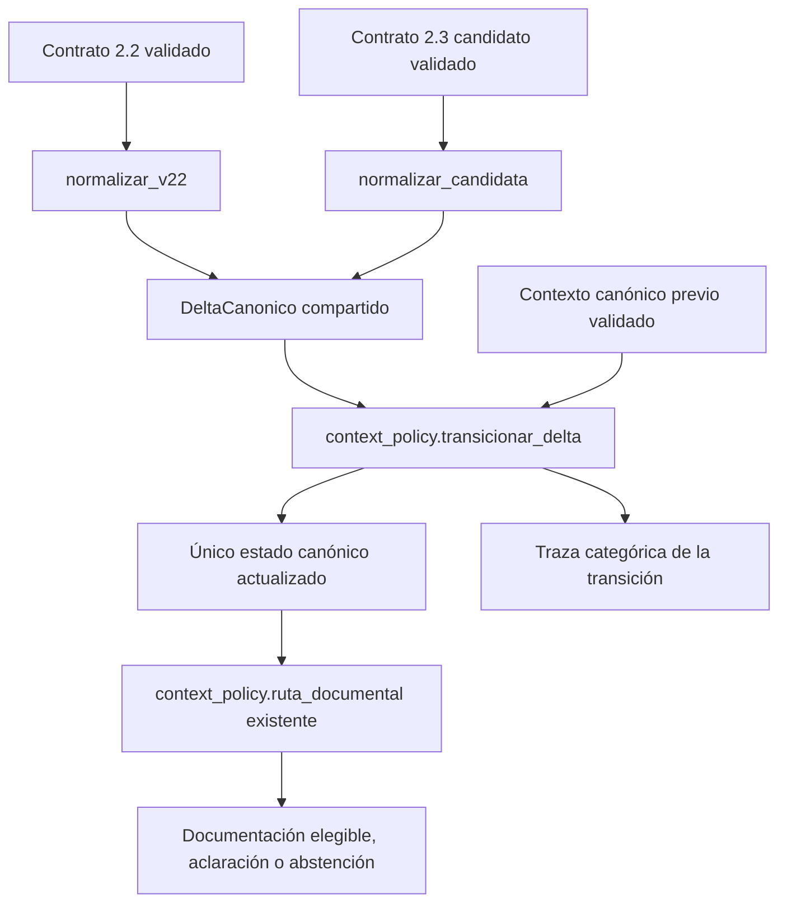

# V2.2F — Delta neutral y política canónica compartida

Base `b6bcd2a`, rama `feature/v2-hybrid-intent`. Se integra determinísticamente `2.3-candidata-1` mediante una entrada experimental explícita, sin productor LLM nuevo, cambios de prompt o integración Gradio/FastAPI. Los contratos de entrada no cambian. No se modifica V1, FAISS, corpus, generación/verificación, n8n, credenciales o concurrencia. No hay dependencias nuevas ni llamadas reales a OpenAI.

## Arquitectura implementada



`transicionar_v2` queda como wrapper de compatibilidad: normaliza 2.2 y delega en `transicionar_delta`. No conserva una segunda implementación del motor V2. V1 mantiene su transición histórica congelada por restricción; la selección documental sigue siendo la misma función compartida `ruta_documental`, sin nuevos procedimientos o rutas.

Los normalizadores traducen sintaxis, actos y procedencia, no consultan el contexto ni el corpus. No resuelven herencia, no infieren edad/identidad ni eligen documentación. La política sigue en `context_policy.py`.

## Delta y objetivo neutral

`app/graph/canonical_delta.py` define un delta cerrado e inmutable con:

- Identificación del objetivo: no mencionado, explícito único, referencia contextual, múltiple o ambiguo; referente ninguno/actual/otro.
- Eventos categóricos con valor, acto, origen y sujeto preservados.
- Dudas materializadas mediante códigos existentes; para 2.2 se conservan sus declaraciones validadas. Para 2.3 se traducen estados lingüísticos del campo, sin generar una lista administrativa desde el LLM.
- Incertidumbre relacional informativa diferenciada de contradicción relacional explícita.

El normalizador legado reconoce la identificación únicamente desde un evento explícito de rol `titular`, nunca desde relación o edad. Conserva la etiqueta legada como proyección compatible. Su indicador de formato no concede autoridad ni modifica los requisitos documentales.

La forma neutral añade el campo canónico opcional `objetivo`, un `DatoContextual` cuyo valor cerrado `identificado` significa solo que existe una selección única confirmada. No es un nombre, UUID de persona, edad o parentesco. No se fabrica `titular=propio/menor/descendiente` para satisfacer el contrato anterior. Edad, relación, tenencia, operación y función documental siguen siendo dimensiones separadas.

Para conservar interfaces y referencias anteriores, un estado exclusivamente 2.2 mantiene su proyección legada. Ambos formatos pasan por la misma transición; solo cambia dónde se representa la prueba de selección del objetivo. Los estados neutrales no se degradan automáticamente a etiquetas familiares.

## Entrada explícita y límites de versión

```python
from app.graph.canonical_adapter import adaptar_contrato

resultado = adaptar_contrato(
    contexto_anterior,
    {"turno": siguiente_turno, "revision": revision_actual},
    payload_candidato,
    version="2.3-candidata-1",
)
contexto_nuevo = resultado.contexto_canonico
ruta = resultado.ruta  # Calculada por ruta_documental real.
traza = resultado.traza
```

`version="2.2"` usa el normalizador de compatibilidad. No se detecta versión por heurística ni se intenta un parser alternativo cuando falla otro. `adaptar_interpretacion` y el productor actuales siguen aceptando únicamente su contrato anterior; la nueva candidata requiere esta entrada experimental.

Los metadatos vienen del llamador interno, no del modelo. Turno/revisión discordantes, contexto inválido, formato incompatible o fallo de adaptación devuelven bloqueo y un código cerrado. No se reutiliza la ruta histórica ni se emite la excepción o el payload en logs.

Se permite migrar explícitamente un estado legado validado a neutral si su rol ya estaba confirmado y sin duda de titular. La prueba neutral conserva exactamente turno, revisión y origen originales: no convierte historia en evidencia nueva. Si no hay prueba confirmada, queda desconocida y una referencia sola no basta. Esta migración de representación no deriva identidad del valor de parentesco.

El camino inverso no existe: pasar un estado neutral a la entrada 2.2 devuelve `version_estado_incompatible`; la transición también lo rechaza defensivamente. Para volver a un consumidor exclusivamente legado debe iniciarse otra conversación, no inventar etiquetas. La mezcla de contratos dentro de un flujo activo no se habilita con esta entrega.

## Invariantes y decisiones

| Caso | Política real |
| --- | --- |
| Objetivo explícito único | Confirma selección neutral sin exigir parentesco o edad artificiales |
| Referencia contextual | Solo comprueba contra objetivo y dato confirmados, de la revisión vigente; conserva procedencia y turno |
| Cambio inequívoco a otro referente | Incrementa revisión e invalida hechos dependientes; no recupera edad, operación o tenencia anteriores |
| Varios objetivos o referencia ambigua | Bloquea selección y dependencias; un tema posterior no cierra esa duda |
| Relación incierta con objetivo conocido | Registra incertidumbre informativa sin convertirla en identidad incierta; no cambia objetivo ni edad |
| Contradicción relacional explícita | Mantiene bloqueo, no se descarta como simple incertidumbre |
| Edad incompatible o incertidumbre material | Mantiene pendiente de edad y bloquea todas las rutas hasta resolución pertinente |
| Hechos de acompañante | No confirman datos del objetivo; función documental de apoyo no habilita una operación |
| Operación observada | No inicia ni rehabilita operación; puede conservar una operación vigente compatible |
| Operación rechazada | Solo nueva solicitud afirmativa, explícita y no negada del objetivo puede rehabilitarla |
| Aclaración de operación | No inicia una operación ni la cambia por otra sin aceptación; puede confirmar una operación/propuesta compatible vigente |
| Coste/requisitos/cita/plazo | Aprovechan hechos confirmados, pero no cancelan pendientes materiales |
| Adulto/duplicado sin corpus | Se identifica sin inventar ruta; el selector devuelve vacío y corresponde abstención |

Los rechazos pertenecen a la revisión del objetivo. Un cambio inequívoco reinicia esa revisión y exige datos nuevos del nuevo procedimiento; no hereda supuestas aceptaciones ni operaciones. Ante ambigüedad se conservan rechazos y no se selecciona un nuevo objetivo.

`validar_contexto` comprueba el campo neutral cuando existe y rechaza un procedimiento ordinario sin objetivo confirmado ni pendiente que explique su ausencia. Seguimiento genérico conserva sus requisitos propios. Se permite incertidumbre relacional informativa únicamente con objetivo confirmado; las contradicciones explícitas se materializan como pendientes por el normalizador y la política.

Se reforzó el guard de aclaración de operación para evitar iniciar o sustituir una operación mediante ese acto. Es una restricción compartida por ambas versiones; no se alteraron expectativas para hacerla pasar. V1 no utiliza esta transición.

## Trazabilidad sin historial paralelo

Cada resultado lleva código técnico, contexto, ruta real y traza separada. La traza contiene únicamente delta normalizado, cambios categóricos por campo, pendientes antes/después, turno, revisión y cambio de revisión. Se conservan los tiempos/orígenes de hechos heredados para distinguirlos de confirmaciones nuevas.

No se persiste traza, delta o lista de eventos dentro del contexto. No hay registros de personas ni historial alternativo. No se copian pregunta, salida cruda, excepciones, credenciales, `ultima_ruta` o campos arbitrarios. Un contexto con datos extra no pasa la frontera; la traza de rechazo parte de un contexto inicial seguro.

Los [ejemplos de trazas sintéticas](v2.2f-trazas-sinteticas.json) incluyen repregunta heredada, cambio a adulto, rechazo y conflicto de edad. No son conversaciones reales ni transcripciones.

## Evaluación y regresiones

```bash
# Solo fixtures; no hay modo real o configuración de modelo en esta herramienta.
python scripts/evaluate_canonical_versions.py --version 2.2 --modo conversacion
python scripts/evaluate_canonical_versions.py --version 2.2 --modo aislados
python scripts/evaluate_canonical_versions.py --version 2.3-candidata-1 --modo conversacion
python scripts/evaluate_canonical_versions.py --version 2.3-candidata-1 --modo aislados \
  --diagnostico --output /tmp/canonico-23.json
```

Se usan las 14 conversaciones/29 turnos y sus expectativas originales, sin modificarlas. Los fixtures candidatos escritos en V2.2E se trasladaron sin conversión ni cambios de contenido desde el módulo de pruebas a `scripts/v23_interpretation_scenarios.py`, para reutilizarlos en evaluación y pruebas. El contrato candidato también permanece idéntico.

En turnos aislados los prefijos se construyen ejecutando la política real sobre fixtures; no se sustituyen las decisiones por mocks, ni se usa la ruta esperada para fabricar contexto. Son contextos controlados, no un oráculo semántico independiente; el modo conversacional prueba además el arrastre completo. Las rutas originales solo puntúan resultados, nunca dirigen la transición.

| Versión | Modalidad | Decisiones correctas | Positivas autorizadas | Autorizaciones incorrectas |
| --- | --- | --- | --- | --- |
| 2.2 | Conversación | 29/29 | 17/17 | 0 |
| 2.2 | Aislados | 29/29 | 17/17 | 0 |
| 2.3 candidata | Conversación | 29/29 | 17/17 | 0 |
| 2.3 candidata | Aislados | 29/29 | 17/17 | 0 |

El [informe separado por versión/modalidad](v2.2f-evaluacion-determinista.json) recoge estos resultados. La herramienta exige 29 filas y todas las decisiones correctas para aprobar. Las pruebas de matriz invocan normalizadores, transición y selector reales; únicamente las pruebas de fallo inyectan excepciones o spies para verificar el bloqueo y la delegación única.

Las regresiones multivuelta/adversariales cubren cambio de referente, datos heredados, selección posterior a varios objetivos, fuente contextual incompatible, rechazo y rehabilitación, aclaración indebida, negación y aceptación simultáneas, edad, tenencia, relación incierta/contradictoria, documentos de apoyo, metadatos obsoletos, contextos corruptos, downgrade de versión y trazas sin información personal.

La suite completa obtuvo **667 pruebas aprobadas y 6 de integración excluidas**: las 617 anteriores y 50 nuevas regresiones. Persisten 12 advertencias de deprecación, sin fallos. `git diff --check` correcto. Se mantienen todos los casos anteriores; solo se trasladaron sus fixtures candidatos, sin cambiar aserciones. Se comparó V1 y el selector por bytes/AST, y productor/prompt, contratos, configuración, expectativas y referencias permanecen intactos.

## Compatibilidad, retirada y riesgos

El normalizador 2.2 existe porque el productor actual y sus pruebas todavía emiten ese contrato. Su wrapper no conserva una segunda política. Tras una futura evaluación y activación explícita de un productor 2.3, podrá retirarse ese lector según una ventana acordada; no se necesita mantener dos motores de interpretación o catálogos.

No se activa todavía un productor candidato, selector de contrato en sesiones de usuario o migración de Gradio/FastAPI. Los estados son en memoria como antes; no se certifica restauración de checkpoints neutrales en un despliegue ni migración concurrente entre canales. No se cambia el mecanismo de sesiones.

Los marcadores de objetivo siguen dependiendo de una interpretación correcta: dos personas de la misma categoría pueden confundirse si la extracción omite el cambio de referente. Los normalizadores no comprenden texto, inventan identidades ni certifican verdad factual. Las referencias no representables se bloquean conservadoramente.

No se afirma mejora semántica del LLM. Esta fase no utiliza OpenAI real ni cambia de modelo; las métricas demuestran integración determinista e invariantes sobre fixtures y política real. Tampoco se certifica Windows nativo nuevo, calidad factual del corpus o preparación de producción.
