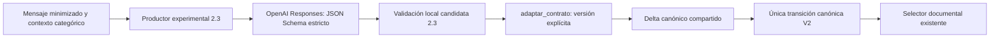

# V2.2G — Productor experimental 2.3 y comparación

Base: `17f1547`, exclusivamente `feature/v2-hybrid-intent`. Esta fase prepara la evaluación real; no demuestra mejoras semánticas del modelo. No se ha llamado a OpenAI real.

## Arquitectura



`app/services/interpretation_service23.py` reutiliza la configuración OpenAI existente (inicialmente `gpt-4.1-mini`), timeout y proveedor inyectable. Solicita `2.3-candidata-1` directamente mediante Responses, con `strict=true`, todos los campos requeridos y objetos cerrados. El [esquema remoto exportado](v2.2g-esquema-remoto23.json) deriva del modelo local: elimina defaults y convierte constantes en enumeraciones. Los campos opcionales se representan mediante null; no hay listas redundantes de evidencias.

Objetivo, relación, edad, DNI previo, tema, función documental y actos por operación permanecen separados. El prompt pide evidencia lingüística, nunca requisitos administrativos ni rutas. Se valida el JSON original con `validar_candidata` antes de entregar al adaptador con versión explícita. No se reparan duplicaciones, contradicciones ni valores desconocidos. La validez contractual no implica suficiencia semántica o autorización.

La única política sigue siendo `transicionar_delta` y la selección sigue en `ruta_documental`. No se conecta el productor a Gradio, FastAPI ni al grafo activo V1. No cambian corpus, FAISS, redacción, verificador, n8n ni dependencias.

## Sesiones y fallos seguros

Cada productor rechaza estados de la otra versión antes de invocar al proveedor. El adaptador conserva sus capacidades explícitas de migración, pero los productores no migran sesiones activas. La primera respuesta fallida conserva un marcador neutral desconocido, sin inventar identidad. Al salir de ámbito se conserva también el formato neutral vacío: una corrección de dos líneas en la transición V2 evita que el siguiente turno se confunda con una sesión 2.2. No altera rutas ni la transición V1.

Timeout, rechazo, respuesta incompleta, JSON inválido, claves duplicadas, excepciones y conflictos de contexto producen bloqueo seguro; no recuperan una ruta histórica. El cliente no reintenta automáticamente. Un modelo que rechace el esquema produce fallo técnico, sin fallback a extracción libre. La compatibilidad remota efectiva queda pendiente de una evaluación real autorizada; se ha probado la serialización SDK con transporte HTTP simulado.

## Privacidad

Se envían únicamente el mensaje actual minimizado y categorías canónicas permitidas, sin historial ni última ruta documental. La minimización existente es parcial: no garantiza anonimización de todo texto libre. No se registran consultas, respuestas completas, excepciones del proveedor ni credenciales. Se conserva el bloqueo de logging DEBUG del SDK/HTTP y se solicita `store=false`; esto no certifica políticas de retención del proveedor. Los diagnósticos opcionales contienen valores enumerados, actos, procedencias, sujetos, pendientes y condiciones documentales. El resultado validado en memoria no es un historial persistente paralelo.

## Evaluador reproducible

`scripts/compare_interpretation_versions.py` conserva las 14 conversaciones y 29 turnos y sus expectativas originales. Cada versión/modalidad usa su propio servicio y contexto. En simulación el proveedor devuelve contratos fixture; tanto estos como los contextos de referencia pasan por el adaptador y la política reales. No se simulan decisiones documentales.

```bash
.venv/bin/python -m scripts.compare_interpretation_versions --simulated --version ambas --modo ambos --diagnostico --output /tmp/comparacion-v22g.json
GRADIO_ANALYTICS_ENABLED=False .venv/bin/python -B -m pytest -q -p no:cacheprovider
```

Existe `--real`, únicamente para una futura solicitud explícita y configuración válida. Puede seleccionarse `--version 2.3-candidata-1 --modo conversacion`. No se ejecutó en esta entrega. Falta de configuración devuelve error antes de crear un cliente. Una interrupción técnica detiene la batería y no permite declarar éxito. Tampoco aprueban ejecuciones vacías, incompletas o con expectativas internas incompatibles.

### Métricas separadas

- **Contrato**: validez entre respuestas recibidas; **entrega válida**: validez entre todos los turnos ejecutados, incluidos fallos de proveedor.
- **Interpretación semántica**: coincidencia de dimensiones críticas originales entre respuestas válidas. La correspondencia neutral compara objetivo y relación independientemente. Se preservan actos, procedencias y sujetos; observación no equivale a solicitud.
- **Transición controlada**: concordancia canónica cuando el contrato fixture completo y el contexto de entrada son conformes. Su denominador se informa por separado; un error semántico no se atribuye automáticamente a la política.
- **Decisión documental**: coincidencia de ruta y tipo de decisión en todos los turnos ejecutados; incluye positivos, bloqueos y abstenciones.
- **Seguridad y utilidad**: positivas esperadas/autorizadas, autorizaciones incorrectas, aclaraciones necesarias atendidas e innecesarias.
- **Coste técnico**: latencia p50/p95 del servicio completo sin rúbrica y tokens de entrada/salida, con procedencia por turno. Las estimaciones no se confunden con uso facturado.

La rúbrica conserva las equivalencias acotadas existentes; para 2.3 aplica su correspondencia categórica explícita. La coincidencia completa con el fixture se informa aparte: un tema auxiliar ausente que no era dimensión crítica del escenario no se convierte en error semántico. No se equiparan negación y aceptación ni evidencia contextual y explícita. El contexto de entrada conforme se verifica separadamente para distinguir arrastre de errores primarios.

El diagnóstico adicional registra traza y código de adaptación 2.3, condiciones y pendientes. En 2.2 no existe ese código y se indica null. Una salida inválida no permite reconstruir su intención; los códigos cerrados localizan la validación, no prueban comprensión. Las referencias sintéticas tampoco permiten atribuir automáticamente toda discrepancia real.

## Resultados simulados y costes

El [informe resumido reproducible](v2.2g-comparacion-simulada.json) recoge cuatro baterías independientes: versiones 2.2 y 2.3, conversación y aislados. En cada una: **29/29 contratos, interpretaciones críticas, transiciones evaluables y decisiones conformes; 17/17 positivas autorizadas; cero autorizaciones incorrectas; 8/8 aclaraciones necesarias atendidas y cero innecesarias**. Son fixtures controlados, no resultados de comprensión del LLM. Las latencias corresponden al proveedor simulado.

Suite completa: **734 aprobadas, 6 excluidas, 12 advertencias de dependencias**. Se conservan las 667 pruebas anteriores y se añaden 67: schema, transporte SDK simulado, privacidad, fallos, aislamiento de versiones, recuperación, multivuelta, rúbrica y baterías adversariales del comparador.

Cada versión/modalidad requiere como máximo 29 peticiones: ambas versiones en conversación, 58; ambas versiones en ambos modos, 116. El productor 2.3 limita la salida a 1600 tokens por petición y no reintenta. El presupuesto de entrada depende del esquema y del contexto enviados. Sin usage, se estima por bytes/4; no es tokenización exacta ni precio. El coste monetario requiere tarifas vigentes y uso real. El resumen conserva estimaciones sintéticas únicamente para verificar instrumentación.

## Compatibilidad y pendientes

Permanecen intactos los contratos, normalizadores, adaptador, fixtures originales, prompt/esquema 2.2 y selector documental. Los únicos cambios a componentes existentes son el rechazo de mezcla de versiones en el productor 2.2 y la conservación de formato neutral al salir de ámbito en V2. No hay otro motor de reglas.

Quedan pendientes: aceptación del esquema por el modelo remoto configurado, calidad semántica real, distribución de errores, latencia/coste reales y restauración operativa de sesiones V2. Una futura evaluación debe conservar versiones separadas y comparar estas mismas expectativas sin ajustarlas a las respuestas del modelo. No se prepara activación en interfaz.
